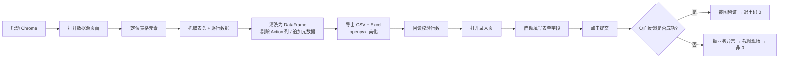

# AutoWeb-RPA-Demo

> 一个用 Python + Selenium 实现的轻量级 RPA 演示：**自动抓取网页表格 → 落盘为 CSV/Excel → 回填表单并提交**。
> 用代码复刻人的「眼睛 + 手 + 检查」，把高频、重复的网页数据搬运变成一条命令。


---

## 💡 项目痛点

日常工作中存在大量**「复制—粘贴—再提交」**式的机械劳动：

- 每天从后台导出表格，人工抄进另一套系统的录入页；
- 几十上百条数据，逐条打开、逐条填写、逐条提交；
- 人一累就出错：看错行、漏填字段、粘错列、重复提交；
- 一次操作动辄十几分钟，做完还不确定有没有漏。

这类工作**技术含量为零，但占用了大量时间，且错误成本不低**。
`AutoWeb-RPA-Demo` 要解决的就是这一件事：把这段机械流程交给脚本。

## 🚀 解决方案

基于 **Python + Selenium** 编写自动化脚本，模拟人类浏览器的「**感知 → 决策 → 操作 → 校验**」闭环：

| 人的动作 | 脚本的实现 |
| --- | --- |
| 用眼睛找元素 | CSS Selector / ID 定位 + 显式等待（`WebDriverWait`） |
| 用鼠标点击 | `element.click()`，并自动滚动到可视区避免被遮挡 |
| 用键盘输入 | `element.clear()` + `send_keys()` |
| 检查是否提交成功 | 等待页面出现成功反馈文本，成功后自动截图留证 |

整个过程不需要人工介入，也不需要目标网站提供 API。

## ⚙️ 核心流程

```text
┌──────────────────────────────────────────────────────────────────────┐
│                        AutoWeb-RPA-Demo 主流程                       │
└──────────────────────────────────────────────────────────────────────┘

  [1] 启动 Chrome           Selenium Manager 自动匹配并拉起 chromedriver
        │
        ▼
  [2] 打开发布页（数据源）   等待 document.readyState === "complete"
        │
        ▼
  [3] 定位表格 & 提取数据    读取 thead 表头 + 逐行读取 tbody td
        │                  → 自动剔除无意义的 Action 列
        ▼
  [4] 写入本地文件          pandas → data/web_table_data.csv（UTF-8 BOM）
        │                  pandas + openpyxl → data/web_table_data.xlsx
        │                  （冻结首行 / 表头样式 / 自适应列宽 / 开启筛选）
        ▼
  [5] 回读校验              重新读取 CSV，比对行数，防止"写了一半"的静默失败
        │
        ▼
  [6] 打开录入页（目标系统） 自动填写姓名、邮箱、备注等字段
        │
        ▼
  [7] 点击提交 & 断言        等待页面出现「提交成功」，否则抛业务异常
        │
        ▼
  [8] 截图留证               data/screenshots/success_*.png
        │
        ▼
  [9] 关闭浏览器 & 输出退出码  0 成功 / 2 超时 / 3 元素缺失 / 4 浏览器异常
```

对应的 Mermaid 版本（GitHub 可直接渲染）：



## ✨ 功能特性

- **双运行模式**
  - `--local`：使用内置离线演示页（`demo_pages/`），**不依赖任何外网**，适合录屏、CI、断网演示；
  - 默认：访问 [the-internet](https://the-internet.herokuapp.com/) 公开测试站，更贴近真实网页。
- **完善异常处理**：按「超时 / 元素缺失 / 浏览器异常 / 业务异常 / 手动中断」分流，每类都有独立退出码与现场截图。
- **显式等待**：全程 `WebDriverWait` + `expected_conditions`，不写 `time.sleep()` 硬等待。
- **数据可追溯**：导出文件自动追加 `row_no`、`scraped_at` 两列。
- **Excel 开箱即用**：冻结表头、深蓝表头白字、自适应列宽、开启筛选，可直接交付给业务方。
- **中文不乱码**：CSV 使用 `utf-8-sig`（带 BOM），双击用 Excel 打开正常显示。
- **日志可回溯**：控制台 + `logs/rpa_*.log` 双写，每次运行独立分文件。

## 📦 快速开始

### 1. 环境要求

| 项目 | 版本 / 说明 |
| --- | --- |
| Python | 3.9 及以上 |
| Chrome | 已安装即可，**无需手动下载 chromedriver**（Selenium 4.6+ 内置 Selenium Manager 自动匹配） |
| 操作系统 | Windows / macOS / Linux 均可 |

### 2. 安装依赖

```bash
git clone https://github.com/kelishi1122-star/AutoWeb-RPA-Demo.git
cd AutoWeb-RPA-Demo

# 建议使用虚拟环境
python -m venv .venv
# Windows
.venv\Scripts\activate
# macOS / Linux
source .venv/bin/activate

pip install -r requirements.txt
```

### 3. 运行

```bash
# 推荐先跑离线模式（不需要外网，最快看到效果）
python main.py --local

# 跑公网公开测试站
python main.py

# 无头模式（CI / 服务器）
python main.py --local --headless

# 跑完保留浏览器窗口，方便对着屏幕讲解
python main.py --local --keep-open
```

### 4. 命令行参数

| 参数 | 说明 | 默认值 |
| --- | --- | --- |
| `--local` | 使用内置离线演示页，不访问外网 | 关闭 |
| `--headless` | 无头模式，不弹出浏览器窗口 | 关闭 |
| `--timeout SEC` | 单个元素最长等待秒数 | `10` |
| `--page-load-timeout SEC` | 页面加载最长等待秒数 | `30` |
| `--keep-open` | 流程结束后保留浏览器，按回车关闭 | 关闭 |
| `-v, --verbose` | 输出 DEBUG 级日志（含完整堆栈） | 关闭 |

### 5. 运行输出

```text
18:00:12 | INFO    | AutoWeb-RPA-Demo 启动 | 模式=离线演示（demo_pages） | headless=False
18:00:13 | INFO    | 启动 Chrome（headless=False）
18:00:14 | INFO    | [1/4] 打开数据源页面并抓取表格
18:00:14 | INFO    | 打开页面 -> file:///.../demo_pages/table.html
18:00:15 | INFO    | 抓取完成：4 行 x 7 列
18:00:15 | INFO    | [2/4] 导出数据到本地文件
18:00:15 | INFO    | CSV 已生成: data/web_table_data.csv（4 行）
18:00:15 | INFO    | Excel 已生成: data/web_table_data.xlsx（4 行）
18:00:15 | INFO    | 落盘校验通过：CSV 回读 4 行，与内存一致
18:00:16 | INFO    | [3/4] 打开录入页面并自动填写表单
18:00:16 | INFO    | 输入 -> cust_name = 'John Smith'
18:00:16 | INFO    | 输入 -> cust_email = 'jsmith@gmail.com'
18:00:17 | INFO    | 表单提交成功：提交成功：John Smith 的资料已登记（离线演示）
18:00:17 | INFO    | [4/4] 校验页面反馈
18:00:17 | INFO    | 截图已保存: data/screenshots/success_20260101_180017.png
18:00:17 | INFO    | RPA 流程执行成功
```

产出物：

```text
data/
├── web_table_data.csv          # UTF-8 BOM，Excel 直接打开
├── web_table_data.xlsx         # 带样式的工作簿
└── screenshots/
    ├── success_*.png           # 成功凭证
    └── error_*.png             # 出错现场（自动保存）
logs/
└── rpa_20260101_180012.log     # 本次运行完整日志
```

## 🛡 异常处理设计

这是本项目最值得讲的部分。异常不是「抓到一个 Exception 然后 print」，而是**分层归因 + 现场取证 + 退出码语义化**。

| 异常类型 | 典型触发场景 | 处理策略 | 退出码 |
| --- | --- | --- | --- |
| `TimeoutException` | 网络慢、页面改版、选择器过期、元素被遮挡不可见 | 记录选择器、保存 `error_timeout_*.png`、返回码 2 | `2` |
| `NoSuchElementException` | 目标元素被删除或 ID 变更 | 保存现场截图、提示检查选择器 | `3` |
| `WebDriverException` | Chrome 未安装、驱动版本不匹配、页面崩溃 | 提示核对 Chrome 版本、返回码 4 | `4` |
| `RpaDataError` | 页面打开了但表格为空 / 缺少表头 | 作为业务异常上报，不重试 | `1` |
| `RpaActionError` | 表单提交后页面提示「登录失败」等非成功态 | 先取页面提示文案再判断，错误原因更明确 | `1` |
| `KeyboardInterrupt` | 用户按 Ctrl+C | 捕获后优雅关闭浏览器，释放进程 | `130` |
| 其他 `Exception` | 未预料的问题 | 记录完整堆栈到日志，避免"静默失败" | `1` |

两个细节，面试时可以直接展开：

1. **异常顺序**：`TimeoutException` 和 `NoSuchElementException` 都是 `WebDriverException` 的子类，必须写在父类前面，否则永远进不了分支。
2. **截图也要 try**：出错时页面可能已经崩溃，`save_screenshot` 自己也会抛异常——所以截图函数内部再包一层 try，**绝不让取证逻辑覆盖原始错误**。

## 📁 项目结构

```text
AutoWeb-RPA-Demo/
├── main.py               # 核心自动化代码（启动 / 抓取 / 落盘 / 录入 / 校验）
├── requirements.txt      # 依赖包清单
├── README.md             # 项目说明书（本文件）
├── .gitignore            # 忽略虚拟环境、日志、运行产物、浏览器缓存
├── data/                 # 抓取与导出的数据（运行产物不纳入版本管理）
│   └── .gitkeep
├── demo_pages/           # 内置离线演示页，--local 模式使用
│   ├── table.html        #   数据源页（结构与公网 tables 页一致）
│   └── form.html         #   录入目标页（模拟内部登记系统）
└── logs/                 # 运行日志（运行时自动创建）
```

## 🔍 关键实现讲解

**为什么用 `visibility_of_element_located` 而不是 `presence_of_element_located`？**
后者只要元素存在于 DOM 就返回，但元素可能还看不见（`display:none`、动画未完成），此时 `click()` 会失败或点到别处。前者会等到元素真正可见，稳定性高一个量级。

**为什么点击前要 `scrollIntoView`？**
真实网站的吸顶导航、Cookie 横幅经常挡住目标元素，Selenium 会抛 `ElementClickInterceptedException`。先把元素滚到视口中间再点，能规避大部分遮挡问题。

**为什么 CSV 要加 BOM？**
`utf-8-sig` 会在文件头写入 `EF BB BF`。没有它，中文 Windows 上的 Excel 会按 GBK 解码，中文全变乱码——这是数据交付场景里最常见的坑。

## 📈 项目收益

| 指标 | 人工操作 | 本脚本 |
| --- | --- | --- |
| 单次搬运 200 条数据 | 约 15–30 分钟 | 约 8 秒 |
| 字段错位 / 漏填 | 疲劳后概率显著上升 | 定位器固定，0 差错 |
| 可重复执行 | 每次都要重新来一遍 | 一条命令，可挂定时任务 |
| 结果留痕 | 靠人记 | CSV + Excel + 截图 + 日志全留档 |

把原本数十分钟的机械劳动压缩到几秒，且每次结果完全一致——**这才是自动化真正的价值：不是快，而是稳定可复现**。

## 🧭 项目演进与未来规划

### V1.0 阶段（当前版本）
使用 **Python + Selenium** 编写底层自动化脚本，实现浏览器元素的精准定位、数据抓取与模拟自动录入，并配套异常处理、日志、截图取证与结构化导出。

### V2.0 阶段（实操试验）
为了让程序更「懂」界面，我尝试过用 **DSH（Agent 工具调用）** 去识别窗口、驱动系统工具，验证了「**AI 负责决策，脚本负责执行**」这条链路的可行性。
结论是：大模型擅长理解「要做什么」，但真正点击、输入、重试这些动作，交给确定性的脚本更稳。

### V3.0 阶段（未来计划）
计划把现有脚本封装成服务，通过 **MCP 协议 / REST API** 暴露能力，直接由大模型（如 **DeepSeek**）调度：

```text
非结构化输入（邮件 / 聊天记录 / 截图 / Excel）
        ↓
   LLM 理解意图 → 拆解为结构化任务 JSON
        ↓
   MCP Server / API（本项目脚本封装层）
        ↓
  影刀 RPA / Selenium 执行稳定的 UI 操作
        ↓
   结果回写 + 异常回传 → LLM 决定重试或转人工
```

目标是形成「**非结构化数据识别（LLM） + 稳定 UI 自动化（RPA）**」的智能体闭环：

- LLM 解决「看不懂的输入」——邮件正文、PDF、截图里的字段提取；
- RPA 解决「不敢让大模型直接干的事」——精确点击、验证码之外的表单填写、跨系统搬运；
- 两者用 MCP 协议衔接，让 Agent 拥有真正能落地的「手」。

## 🤝 合规声明

- 本项目仅用于**技术学习与自动化测试演示**，演示目标为公开测试站点与本地页面；
- 请勿用于绕过验证码、爬取隐私数据或违反目标网站 `robots.txt` 与服务条款的场景；
- 在生产环境使用前，请确认目标系统的授权范围，并优先使用官方 API。

## 📄 License

MIT License，欢迎 Fork、提 Issue、提 PR。
